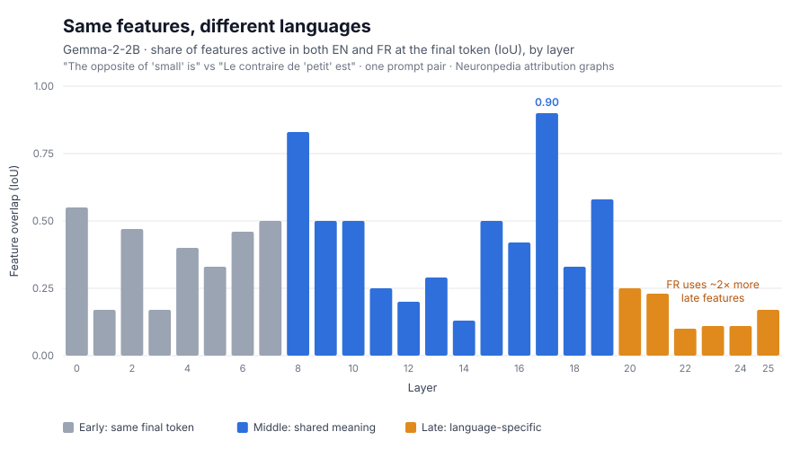

# Multilingual Circuits in Sinhala and Tamil


**Tracing whether a small language model thinks in a shared concept space across languages, starting with English and French and building towards Sinhala (සිංහල) and Tamil (தமிழ்).**



## 🤔 Why?

Anthropic's [*On the Biology of a Large Language Model*](https://transformer-circuits.pub/2025/attribution-graphs/biology.html) found that Claude 3.5 Haiku handles the same idea in English, French and Chinese with **shared, language-independent features** in its middle layers, and only switches to language-specific features at the input and output. They also found that this sharing is **weaker in smaller models** and between **languages that don't share an alphabet**.

That points to a case nobody has tested: **a small open model on low-resource languages with their own scripts.** This project first replicates the finding on Gemma-2-2B, then takes it to Sinhala and Tamil.

## 🔍 Results so far: English vs French

Same question, two languages:

| | Prompt | Model's answer |
|---|---|---|
| 🇬🇧 | `The opposite of "small" is "` | **large** 0.41 · **big** 0.41 · huge · great (≈85% total) |
| 🇫🇷 | `Le contraire de "petit" est "` | **grand** 0.82 · **gros** 0.06 (≈93% total) |

Comparing every feature in the two attribution graphs (same layer + index = same feature):

**1. Shared meaning in the middle layers.** The same "size / large" features fire in both languages:

| Layer | Feature | What it represents | Pushes the model to say |
|---|---|---|---|
| 18 | [#9402](https://www.neuronpedia.org/gemma-2-2b/18-gemmascope-transcoder-16k/9402) | size | *size, sizes, sized* |
| 19 | [#8658](https://www.neuronpedia.org/gemma-2-2b/19-gemmascope-transcoder-16k/8658) | large size | *huge, gigantic* |
| 21 | [#10062](https://www.neuronpedia.org/gemma-2-2b/21-gemmascope-transcoder-16k/10062) | adjectives indicating size | *large, huge, massive* |
| 23 | [#8683](https://www.neuronpedia.org/gemma-2-2b/23-gemmascope-transcoder-16k/8683) | "too" / "large" | *large, larger, big* |

The words **"small" and "petit"** also share 65 features, including [L6 #4362](https://www.neuronpedia.org/gemma-2-2b/6-gemmascope-transcoder-16k/4362) (size) and [L8 #5268](https://www.neuronpedia.org/gemma-2-2b/8-gemmascope-transcoder-16k/5268) (small / miniature).

**2. Language-specific features at the output.** Overlap drops to about 0.1 in layers 22–25. French-only features such as [L20 #1454](https://www.neuronpedia.org/gemma-2-2b/20-gemmascope-transcoder-16k/1454) "French text" and [L22 #10566](https://www.neuronpedia.org/gemma-2-2b/22-gemmascope-transcoder-16k/10566) "French words" pick the French answer, and the French graph uses about **2× as many late-layer features** (199 vs 88).

**3. English as the default.** The shared "say large" features push **English** words, even when the model answers in French. This matches what Anthropic reported for Claude.

**4. French is harder to explain.** The transcoders explain the French graph less well than the English one (replacement score **0.54 vs 0.62**). This is the baseline Sinhala and Tamil will be compared against.

**Not found yet:** a single clean "opposite / antonym" feature. It may be spread across many features or happen in attention, which attribution graphs can't see.

**Explore the graphs:** [English](https://www.neuronpedia.org/gemma-2-2b/graph?slug=theoppositeofsma-1792985373264) · [French](https://www.neuronpedia.org/gemma-2-2b/graph?slug=lecontrairedepet-1792985445354)

Full tables and method details: [`notes/PHASE_1_FEATURES.md`](notes/PHASE_1_FEATURES.md)

### ⚠️ Limitations

- One prompt pair, so these are early observations, not general claims
- No unrelated-prompt baseline yet. Early-layer overlap is inflated because both prompts end in the same `"` token.
- Feature descriptions are Neuronpedia's automatic labels
- Observational so far: the steering experiments that test cause and effect are next

## 🗺️ Roadmap

- [x] Read the papers and plan the project
- [x] Replicate English vs French on Gemma-2-2B
- [ ] Steer the shared features to test cause and effect
- [ ] Check whether Gemma-2-2B can answer the task in Sinhala and Tamil at all
- [ ] Compare feature overlap, transcoder scores and interventions across all four languages
- [ ] Write up the results

## 🛠 Method

| | |
|---|---|
| **Model** | [Gemma-2-2B](https://huggingface.co/google/gemma-2-2b) |
| **Transcoders** | Gemma Scope per-layer transcoders (16k) |
| **Graphs** | [Neuronpedia circuit tracer](https://www.neuronpedia.org/gemma-2-2b/graph), built on [`circuit-tracer`](https://github.com/safety-research/circuit-tracer) |
| **Comparison** | Graph JSON compared feature by feature; intersection-over-union (IoU) of active features at the final token, per layer |

## ⚡ Run it yourself

The fastest route needs no GPU:

1. Open the [Neuronpedia graph tool](https://www.neuronpedia.org/gemma-2-2b/graph)
2. Click **New Graph** and paste one of the prompts above, including the final `"`
3. Click the top output and follow its strongest inputs

There's also a Colab/Kaggle notebook, [`notebooks/01_trace_en_fr.ipynb`](notebooks/01_trace_en_fr.ipynb), that builds the graphs, the overlap plot and the steering tests with `circuit-tracer` directly. It needs an NVIDIA GPU (a T4 is enough) and a Hugging Face token with access to Gemma, and it's still being debugged on free-tier memory limits.

## 📁 Project structure

```
.
├── figures/     # Charts (overlap by layer)
├── notebooks/   # circuit-tracer notebook (Colab / Kaggle)
└── notes/       # Paper notes and Phase 1 results
```

## 📚 References

- Lindsey et al. (2025). [On the Biology of a Large Language Model](https://transformer-circuits.pub/2025/attribution-graphs/biology.html). Transformer Circuits Thread.
- Ameisen et al. (2025). [Circuit Tracing: Revealing Computational Graphs in Language Models](https://transformer-circuits.pub/2025/attribution-graphs/methods.html). Transformer Circuits Thread.
- [Open-sourcing circuit-tracing tools](https://anthropic.com/research/open-source-circuit-tracing), Anthropic

## 🙏 Credits

Built on the circuit-tracing methods and tools released by Anthropic and the `circuit-tracer` authors, Google DeepMind's Gemma Scope transcoders, and Neuronpedia.

**Author:** [methuliH](https://github.com/methuliH)
